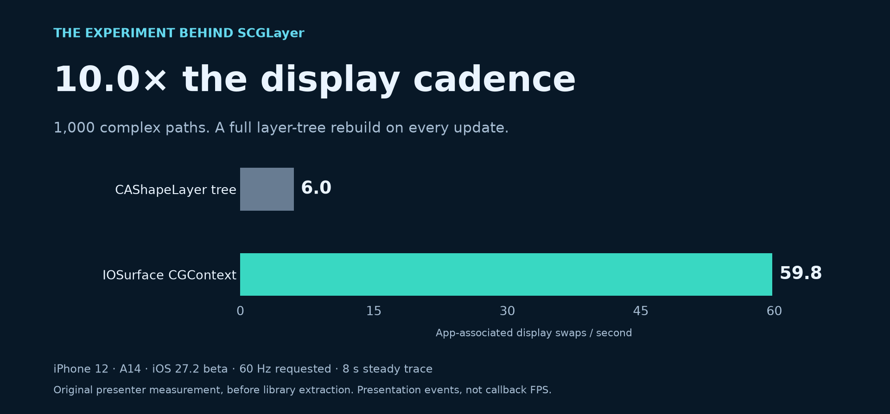
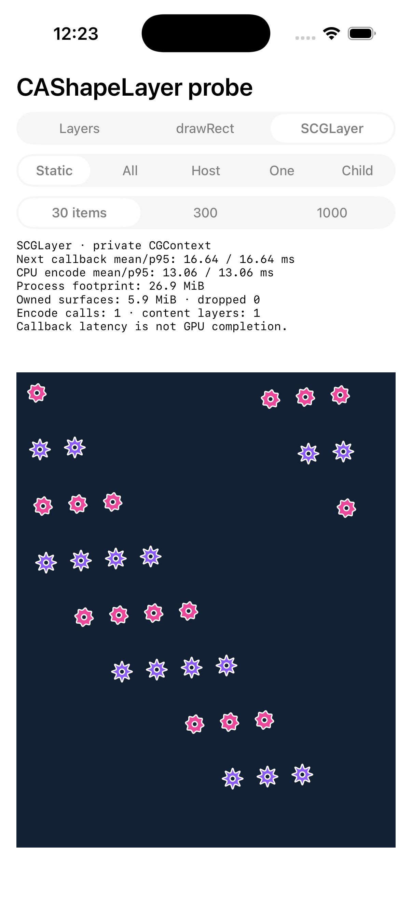
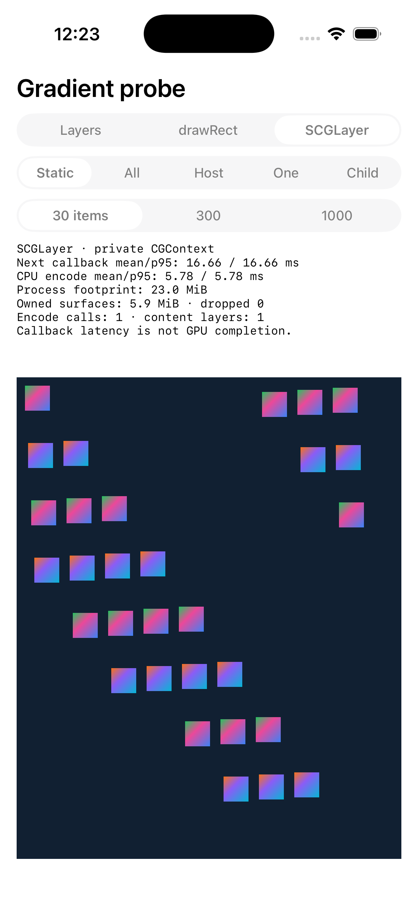

# SuperCoreGraphicLayer

**1,000 complex paths. One CoreGraphics layer.**

An experimental `CALayer` that draws CoreGraphics commands into an IOSurface,
using the private context path also found in WebKit.



**59.8 vs 6.0 display swaps/second** in the experiment that started this project:
1,000 complex paths, every shape layer recreated on every update, iPhone 12.
The next-callback p95 was about **16.8 ms in both cases**. Only the display trace
revealed the difference.

These numbers are from the original IOSurface presenter, before it was extracted
into `SCGLayer`. The library wraps that backend; the standalone demo is a newer
fixture. [Measurement records and limitations →](Benchmarks/README.md)

> **Private API experiment.** This is not an App Store-safe public-API renderer.
> Read the [distribution risks](#private-api-and-distribution-risks) before using it.

## Draw with CoreGraphics

```objc
#import <SCGLayer/SCGLayer.h>

SCGLayer *drawingLayer = [SCGLayer layer];
drawingLayer.frame = self.view.bounds;
drawingLayer.contentsScale = self.view.contentScaleFactor;
drawingLayer.drawingBlock = ^(CGContextRef context, CGRect bounds) {
  CGContextSetRGBFillColor(context, 0.1, 0.85, 0.75, 1.0);
  CGContextFillEllipseInRect(context, CGRectInset(bounds, 24, 24));
};
[self.view.layer addSublayer:drawingLayer];

// When your drawing inputs change:
[drawingLayer setNeedsDisplay];
```

Use your usual paths, fills, gradients, and text drawing calls. The context uses
points and a top-left origin. Keep the layer's frame synchronized with layout.
The pool owns at most three surfaces at a fixed size; busy buffers cause a dropped
update rather than unbounded allocation. Drawing belongs on the main thread.

[Swift example, immediate rendering, errors, and memory semantics →](Docs/API.md)

## Try the demo

<p>
  
  
</p>

Actual simulator screenshots; they show output and controls, not device performance.

Open **[Demo/SCGDemo.xcodeproj](Demo/SCGDemo.xcodeproj)** and run the **SCGDemo**
scheme. Switch between layers, `drawRect`, and SCGLayer. Use `-scene shape` or
`-scene gradient` as launch arguments. Select your own signing team for a device.
The project is standalone and uses the library sources directly.

[Demo instructions →](Demo/README.md) · [Benchmark and trace tools →](Benchmarks/README.md)

## Install

Add `https://github.com/zhongyr/SuperCoreGraphicLayer.git` in Xcode's package
dependencies, select the `main` branch, and add the **SCGLayer** product. The
experimental package currently has no versioned release.

The deployment target is iOS 16. This is a build target, not a claim that the
private APIs work on every supported OS. Simulator functionality was validated
on iOS 26; the archived presenter measurements used an iPhone 12 on iOS 27.2 beta.
Runtime availability and acceleration must be checked on your actual target.

## What the experiment says

| 1,000 complex paths | Rebuilt CAShapeLayer tree | Original IOSurface presenter |
| --- | ---: | ---: |
| App-associated display swaps / second | 6.0 | 59.8 |
| Display-swap spacing p95 | 183.5 ms | 16.7 ms |
| Next callback p95, same trace | 16.8 ms | 16.7 ms |
| App CPU, uninstrumented, % of one core | 59.0% | 70.3% |
| App footprint at end of run | 7.3 MiB | 81.7 MiB |

Display data comes from one 8-second steady trace per condition; process metrics
are medians of two separate 10-second runs. The baseline fully rebuilds the tree;
retained trees have different costs. This is a specific dense-path workload,
not a general speedup for every CALayer or CoreGraphics operation.

**App footprint excludes some render-server and driver allocations.** The table
does not establish total graphics memory savings; this presenter used more App
memory. CPU and memory costs matter alongside displayed cadence. The gradient
results and the excluded incomplete trace are documented in
[Benchmarks](Benchmarks/README.md).

## How it works

1. Allocate aligned BGRA8 IOSurfaces and create an sRGB CGContext with
   `CGIOSurfaceContextCreateWithOptions` (or the older constructor if unavailable).
2. Draw into a reusable non-front buffer and flush pending CGContext work.
3. Publish the IOSurface directly as layer contents for Core Animation.

The app's Metal trace confirmed GPU work in the measured presenter workload.
CoreGraphics still performs CPU work, and individual operations may take different
paths. A successful render call is a submission, not a GPU or presentation fence.
The renderer reports unavailable APIs or allocation failures without substituting
a bitmap implementation. Moving ordinary drawing into `UIView.drawRect:` alone
does not select this private context.

## Private API and distribution risks

- **App Store review:** Apple's [App Review Guideline 2.5.1](https://developer.apple.com/app-store/review/guidelines/#software-requirements)
  requires public APIs. The CGContext constructor and direct IOSurface layer
  contents used here are private interfaces; using them can cause rejection.
  Resolving a symbol with `dlsym` does not make it public or compliant.
- **Compatibility and stability:** Apple can remove or change these interfaces,
  signatures, synchronization behavior, and rendering paths without notice.
  WebKit's use of them does not grant third-party apps the same API guarantees.
- **Operational risk:** crashes, incorrect output, dropped updates, GPU/CPU
  regressions, and increased memory are possible on untested workloads or systems.
  Keep a separately validated public-API renderer for distribution requirements
  that prohibit private APIs.

Use this project for controlled experiments with those constraints understood.
The MIT license covers this project's code; it does not override Apple's terms
or provide approval to distribute an app using private APIs.

References: [WebKit's context signatures](https://github.com/WebKit/WebKit/blob/main/Source/WebCore/PAL/pal/spi/cg/CoreGraphicsSPI.h),
[WebKit's IOSurface implementation](https://github.com/WebKit/WebKit/blob/main/Source/WebCore/platform/graphics/cocoa/IOSurface.mm),
and [Apple's render-loop explanation](https://developer.apple.com/videos/play/tech-talks/10855/).

## Repository

| Path | Contents |
| --- | --- |
| `Sources/SCGLayer` | Public CALayer subclass and private IOSurface renderer |
| `Demo` | Standalone native iOS comparison app |
| `Benchmarks` | Reproduction tools, methodology, exported measurements |
| `Docs` | API details and actual demo screenshots |

MIT licensed. See [LICENSE](LICENSE).
