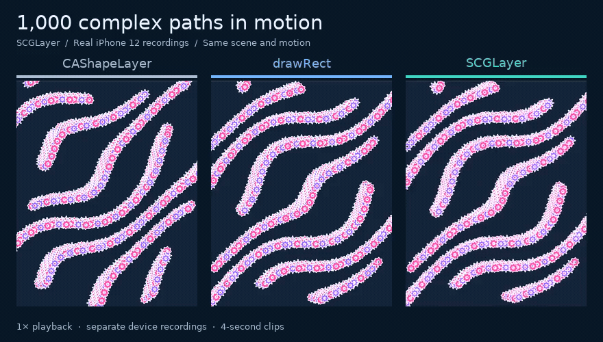
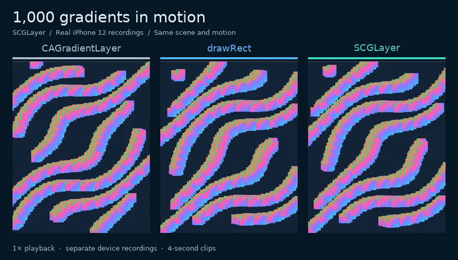

# SuperCoreGraphicLayer

**Same CoreGraphics drawing. Different CGContext backends.**

An experimental `CALayer` that draws CoreGraphics commands into an IOSurface,
using the private context path also found in WebKit.



Actual iPhone 12 screen recordings, captured separately and played at **1× speed**.
All three render the same moving paths; the layer backend rebuilds its entire tree.
The GIF preview is limited to 25 fps. [Watch/download the MP4 →](Docs/assets/shape-comparison.mp4)
This motion showcase is separate from the repaint benchmark below; screen recording adds overhead.

Separate repaint benchmark: **60.0 vs 5.9 display swaps/second — about 10.1× the cadence of `UIView.drawRect:`**
in the standalone SCGLayer demo: 1,000 complex paths, redrawn every update, on
iPhone 12. The fully rebuilt CAShapeLayer reference reached **5.0**.

Both CoreGraphics backends call the same scene-drawing function. `drawRect:` uses
the [UIKit-provided CGContext](https://developer.apple.com/documentation/uikit/uigraphicsgetcurrentcontext%28%29),
while SCGLayer creates a private IOSurface-backed CGContext and publishes the
surface as layer contents. This compares context and presentation paths while
keeping the scene drawing code the same.

Measured through the public SCGLayer interface on a physical device, with five
validated display traces and twelve separate process-measurement runs.
[Measurement records, memory costs, and limitations →](Benchmarks/README.md)

> **Private API experiment.** This is not an App Store-safe public-API renderer.
> Read the [distribution risks](#private-api-and-distribution-risks) before using it.

## Draw with CoreGraphics

```objc
#import <SCGLayer/SCGLayer.h>

SCGLayer *drawingLayer = [SCGLayer layer];
drawingLayer.frame = self.view.bounds;
drawingLayer.contentsScale = self.view.contentScaleFactor;
drawingLayer.drawingBlock = ^(CGContextRef context, CGRect bounds) {
  CGContextSetRGBFillColor(context, 0.1, 0.85, 0.75, 1.0);
  CGContextFillEllipseInRect(context, CGRectInset(bounds, 24, 24));
};
[self.view.layer addSublayer:drawingLayer];

// When your drawing inputs change:
[drawingLayer setNeedsDisplay];
```

Use your usual paths, fills, gradients, and text drawing calls. The context uses
points and a top-left origin. Keep the layer's frame synchronized with layout.
The pool owns at most three surfaces at a fixed size; busy buffers cause a dropped
update rather than unbounded allocation. Drawing belongs on the main thread.

[Swift example, immediate rendering, errors, and memory semantics →](Docs/API.md)

## Try the demo



The same motion with linear gradients. 20 fps GIF preview;
[MP4 video →](Docs/assets/gradient-comparison.mp4).

Select **Motion** in the demo, or launch with
`-scene shape -backend surface -workload motion -count 1000`.
The motion follows elapsed time, so slow renderers skip positions instead of slowing the animation clock.

<details>
<summary>Simulator screenshots</summary>

<p>
  
  
</p>

Actual simulator screenshots; they show output and controls, not device performance.

</details>

Open **[Demo/SCGDemo.xcodeproj](Demo/SCGDemo.xcodeproj)** and run the **SCGDemo**
scheme. Switch between layers, `drawRect`, and SCGLayer. Use `-scene shape` or
`-scene gradient` as launch arguments. Select your own signing team for a device.
The project is standalone and uses the library sources directly.

[Demo instructions →](Demo/README.md) · [Benchmark and trace tools →](Benchmarks/README.md)

## Install

Add `https://github.com/zhongyr/SuperCoreGraphicLayer.git` in Xcode's package
dependencies, select the `main` branch, and add the **SCGLayer** product. The
experimental package currently has no versioned release.

The deployment target is iOS 16. This is a build target, not a claim that the
private APIs work on every supported OS. Simulator functionality was validated
on iOS 26; the packaged library also passed physical-device checks and the
benchmarks below on an iPhone 12 running iOS 27.2 beta (24B5110a).
Runtime availability and acceleration must be checked on your actual target.

## What the experiment says


| 1,000 complex paths | Rebuilt CAShapeLayer tree | drawRect (CoreGraphics) | SCGLayer (CoreGraphics) |
| --- | ---: | ---: | ---: |
| App-associated display swaps / second | 5.0 | 5.9 | 60.0 |
| Display-swap spacing p95 | 350.3 ms | 183.4 ms | 16.7 ms |
| Next callback p95, same trace | 16.8 ms | 175.7 ms | 16.7 ms |
| App CPU, uninstrumented, % of one core | 58.8% | 97.8% | 71.4% |
| App footprint at end of run | 7.2 MiB | 24.2 MiB | 79.5 MiB |

The CAShapeLayer and SCGLayer callback intervals were both near one refresh
period despite very different display cadence. The `drawRect` callback interval
also reflected long App-side drawing work. Presentation comes from the display
trace, independently of those callback measurements.

Display data comes from one 8-second steady trace per condition; process metrics
are medians of two separate 10-second runs. The baseline fully rebuilds the tree;
retained trees have different costs. This is a specific dense-path workload,
not a general speedup for every CALayer or CoreGraphics operation.

For 1,000 linear gradients, the same two CoreGraphics paths reached **48.9**
(`drawRect`) and **59.6** (SCGLayer) display swaps/second.
CAGradientLayer display cadence is unavailable: the captures could not establish
reliable app-associated display events, so no FPS is inferred from those counts.
The size of the benefit depends on the drawing workload.
[Both scenes and raw per-run records →](Benchmarks/README.md)

**App footprint excludes some render-server and driver allocations.** The table
does not establish total graphics memory savings; SCGLayer used more App memory
in this path workload. The three-surface pool itself owned about 16.7 MiB, which
may already be charged to footprint. Do not add the two values.

Six physical-device functional cases and the native checks passed. Busy-buffer
skips were observed, including 8 in the gradient trace run. These counters include
warmup and automatic display passes; they are not a count of missing display frames.
[Validation records and counter scope →](Benchmarks/README.md#device-validation)

## How it works

1. Allocate aligned BGRA8 IOSurfaces and create an sRGB CGContext with
   `CGIOSurfaceContextCreateWithOptions` (or the older constructor if unavailable).
2. Draw into a reusable non-front buffer and flush pending CGContext work.
3. Publish the IOSurface directly as layer contents for Core Animation.

The app's Metal trace confirmed GPU work in the measured SCGLayer workload.
CoreGraphics still performs CPU work, and individual operations may take different
paths. A successful render call is a submission, not a GPU or presentation fence.
The renderer reports unavailable APIs or allocation failures without substituting
a bitmap implementation. Moving ordinary drawing into `UIView.drawRect:` alone
does not select this private context.

## Private API and distribution risks

- **App Store review:** Apple's [App Review Guideline 2.5.1](https://developer.apple.com/app-store/review/guidelines/#software-requirements)
  requires public APIs. The CGContext constructor and direct IOSurface layer
  contents used here are private interfaces; using them can cause rejection.
  Declaring a symbol with `weak_import` does not make it public or compliant.
- **Compatibility and stability:** Apple can remove or change these interfaces,
  signatures, synchronization behavior, and rendering paths without notice.
  WebKit's use of them does not grant third-party apps the same API guarantees.
- **Operational risk:** crashes, incorrect output, dropped updates, GPU/CPU
  regressions, and increased memory are possible on untested workloads or systems.
  Keep a separately validated public-API renderer for distribution requirements
  that prohibit private APIs.

Use this project for controlled experiments with those constraints understood.
The MIT license covers this project's code; it does not override Apple's terms
or provide approval to distribute an app using private APIs.

References: [WebKit's context signatures](https://github.com/WebKit/WebKit/blob/main/Source/WebCore/PAL/pal/spi/cg/CoreGraphicsSPI.h),
[WebKit's IOSurface implementation](https://github.com/WebKit/WebKit/blob/main/Source/WebCore/platform/graphics/cocoa/IOSurface.mm),
and [Apple's render-loop explanation](https://developer.apple.com/videos/play/tech-talks/10855/).

## Repository

| Path | Contents |
| --- | --- |
| `Sources/SCGLayer` | Public CALayer subclass and private IOSurface renderer |
| `Demo` | Standalone native iOS comparison app |
| `Benchmarks` | Reproduction tools, methodology, exported measurements |
| `Docs` | API details and actual demo screenshots |

MIT licensed. See [LICENSE](LICENSE).
